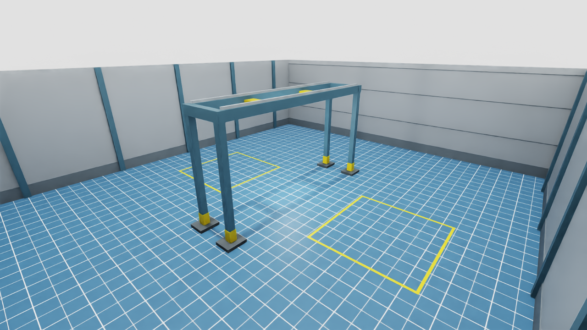
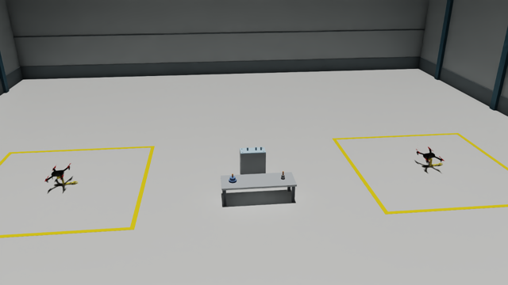
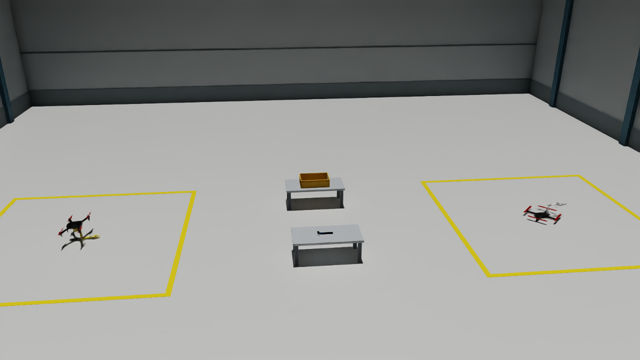
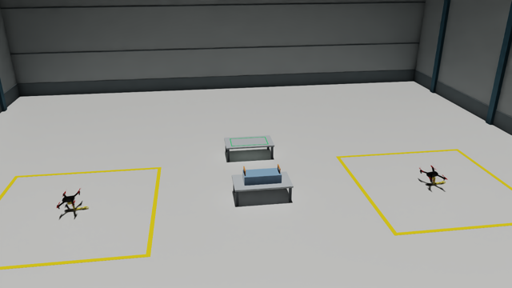
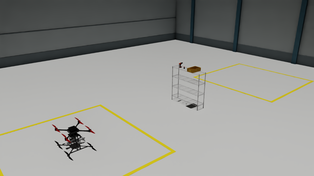
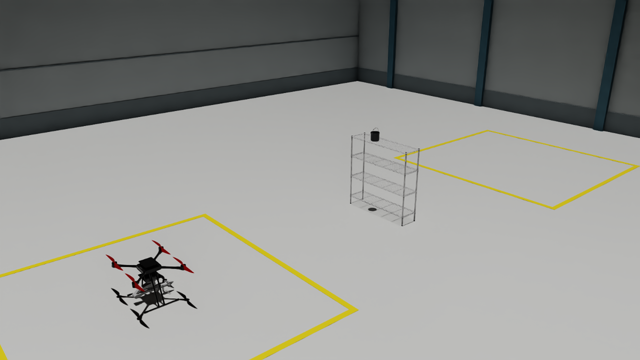

# Aetos_MultiAM

A benchmark for **multi aerial-manipulator (AM) collaboration**: one robot
*type* -- an aerial manipulator (drone + optional arm + optional gripper) --
composed from swappable drone / manipulator / gripper models, built on Isaac
Sim's `omni.isaac.core` API.

📖 **中文详细手册: [`docs/MANUAL_ZH.md`](docs/MANUAL_ZH.md)**

## Key features

- **Six aerial manipulators, all flyable** -- five under-actuated quadrotors
  and one fully-actuated hexarotor, arms from 2 to 6 DOF, end effectors from a
  single jaw to a 12-DOF dexterous hand. See [Embodiments](#embodiments).
- **Keyboard teleoperation of the drone *and* the arm**, as two independently
  selected devices; a real SO-ARM leader arm also drives the SO-ARM presets.
- **Arm-reaction isolation** -- a moving arm costs under 0.7 deg of body tilt
  on every robot, so a controller tuned for a fixed airframe stays stable
  (`arm_dynamics_residual`, `arm_locked_joints`, `arm_write` per preset).
- **6-DOF wrench allocation** for the fully-actuated hexarotor, so it
  translates at a level attitude instead of leaning: worst body tilt over the
  whole mission drops from 8.09 deg to 0.53 deg.
- **Composable assets** -- drone x manipulator x gripper mounted at runtime,
  or baked into a standalone USD per preset.

## Embodiments

Each clip is that robot flying `examples/show_am_action.py`'s scripted mission
at **3x speed**: climb to 1 m, forward 1 m, left 1 m, right 1 m, yaw 180 deg,
forward 1 m, sweep every drivable joint +-45 deg, land.

| preset | rotors | arm DOF | gripper DOF | mission (3x) |
|---|---|---|---|---|
| `amov950_airbot_bottom` | quad (4) | 6 | 2 (airbot_play) |  |
| `amov950_airbot_dexterous_bottom` | quad (4) | 5 | 12 (Inspire Hand) |  |
| `hummingbird340_2dof_gripper` | quad (4) | 2 | 3 (three-finger) |  |
| `iris650_soarm100` | quad (4) | 5 | 1 (SO-ARM jaw) |  |
| `uaquad600_gripper` | quad (4) | 4 | 2 (two-finger) |  |
| `fahexa750_gripper` | **hexa (6)** | 4 | 2 (two-finger) |  |

These six are a fixed set, not an arbitrary runtime combo picker.
`fahexa750_gripper` is fully actuated (6x6 wrench matrix, rank 6, condition
number 4.2): it is flown through a 6-DOF allocator that commands force and
attitude independently, so it slides sideways without tilting. The other five
are under-actuated and lean to translate, as they must. `--controller lee`
flies the hexa the under-actuated way for comparison.

## Installation

Linux only -- Isaac Sim does not support Windows. The stack below is what
this benchmark is developed and tested on; the Isaac Sim / Python / torch
rows are the ones that actually have to match, the rest is context.

| | version |
|---|---|
| OS | Ubuntu 22.04.5 LTS |
| GPU / driver | RTX 3080 Ti Laptop, 580.126.09 |
| Isaac Sim | **4.1.0** |
| Isaac Lab | 0.20.0 (`omni.isaac.lab`) |
| Python | **3.10** (conda env, not Isaac Sim's bundled interpreter) |
| PyTorch | **2.2.2+cu121** |
| torchrl / tensordict | **0.3.1** / 0.3.1 |
| numpy | 1.26.0, from Isaac Sim's `pip_prebundle` |

### 1. Isaac Sim 4.1.0

Install it per the [Omniverse
docs](https://docs.omniverse.nvidia.com/isaacsim/latest/installation/install_workstation.html),
then point `ISAACSIM_PATH` at it in `~/.bashrc`. Any location works -- this
machine uses a standalone unpack, not the Omniverse Launcher layout:

```bash
export ISAACSIM_PATH=/home/benhua/isaacsim
# launcher installs instead look like:
# export ISAACSIM_PATH="${HOME}/.local/share/ov/pkg/isaac-sim-4.1.0"
```

### 2. Conda environment

Isaac Sim ships its own Python, but a separate conda env is far easier to
work in. [OmniDrones](https://github.com/btx0424/OmniDrones) provides the
activate/deactivate hooks that put Isaac Sim on the interpreter's path --
copy them into the env (the env name is arbitrary; `aetos` here):

```bash
conda create -n aetos python=3.10
conda activate aetos

# from the OmniDrones checkout
cp -r conda_setup/etc "$CONDA_PREFIX"
conda activate aetos   # re-activate so the hook runs

# verification
python -c "from isaacsim import SimulationApp"
python -c "import torch, numpy; print(torch.__version__, numpy.__version__)"
# -> 2.2.2+cu121 1.26.0
```

> `ISAACSIM_PATH` must be exported **before** `conda activate`: the hook
> sources `$ISAACSIM_PATH/setup_conda_env.sh`, and that is what puts Isaac
> Sim's numpy 1.26 ahead of whatever the env itself has. Skip it and `import
> torch` dies with *"A module that was compiled using NumPy 1.x cannot be run
> in NumPy 2.x"* -- nothing in the message mentions Isaac Sim.

### 3. Isaac Lab

```bash
sudo apt install cmake build-essential
git clone git@github.com:isaac-sim/IsaacLab.git
conda activate aetos
pip install usd-core==23.11 lxml==4.9.4 tqdm xxhash   # pinned by nvidia-srl-usd
cd IsaacLab && ./isaaclab.sh --install
```

### 4. OmniDrones, then this repo

`aetos_multiam` imports `omni_drones` directly (rotor actuators, the Lee
controller, `IsaacEnv`), so OmniDrones goes in first -- not upstream, but the
fork plus the changes kept in `third_party/omnidrones/` (see its README):

```bash
git clone https://github.com/gaobh1202/amov_omni.git OmniDrones
cd OmniDrones && git checkout "$(cat /path/to/Aetos_MultiAM/third_party/omnidrones/BASE_COMMIT)"
bash /path/to/Aetos_MultiAM/third_party/omnidrones/apply.sh .
pip install -e .
pip install -e /path/to/Aetos_MultiAM
```

### 5. Assets

Robot model binaries (USD + MJCF mesh geometry, ~400 MB) are not committed.
Download and unpack them into `aetos_multiam/assets/meshes`, and fetch the
IsaacLab Factory gears `AerialAssembly` uses -- both in
[`docs/ASSETS.md`](docs/ASSETS.md).

### 6. Check it works

```bash
export ISAACSIM_PATH=/home/benhua/isaacsim
conda activate aetos

python examples/show_robot.py --robot all --headless    # all six robots spawn
python debug/verify_iris650_flight.py                   # one of them actually flies
python scripts/run_aerial_button_grasp.py task=AerialButtonGrasp headless=true
```

Run everything through this conda env, never through Isaac Sim's own
`python.sh` -- that interpreter has neither `aetos_multiam` nor
`omni_drones` installed. Tasks default to the **GPU** PhysX pipeline
(`cfg/base/sim_base.yaml`): `AerialAssembly`'s gears use SDF colliders,
which have no collision at all on a CPU pipeline.

## Usage

### View a preset

```bash
python examples/show_robot.py --robot iris650_soarm100
python examples/show_robot.py --robot all            # all six side by side
python examples/show_robot.py --robot all --headless # screenshot only
```

### View a scene

Arenas with no robot in them -- for checking layout and dimensions before a
task exists:

```bash
python examples/show_scene.py --scene default      # ground plane, nothing else
python examples/show_scene.py --scene warehouse    # enclosed bay, 2 spawn zones, gantry
python examples/show_scene.py --scene warehouse --floor concrete --headless
```

`WarehouseArena` is an 18 x 20 x 5.4 m bay with two 3.8 x 4.0 m yellow spawn
zones at x = +-4.5 and a four-post gantry between them (8 m span, beam at
4.43 m) for task objects to hang from. The floor is AM-Bench's own ground
plane; `--floor concrete` swaps it for a plain slab.



### Fly the scripted mission

```bash
python examples/show_am_action.py --preset uaquad600_gripper
python examples/show_am_action.py --preset all     # all six in one scene
python examples/show_am_action.py --preset all --headless --video out.mp4

# fly the fully-actuated hexa as an under-actuated one, to see the difference
python examples/show_am_action.py --preset fahexa750_gripper --controller lee
```

### Teleoperate

`examples/aerial_manipulator_control_demo.py` drives the drone body and the
arm from two independently-selected devices:

| flag | values | default |
|---|---|---|
| `--uav_control` | `none`, `keyboard` | `none` (holds its spawn setpoint) |
| `--arm_control` | `none`, `keyboard`, `soarm_leader` | `none` (holds its rest pose) |
| `--arm_dynamics` | `frozen`, `coupled` | `frozen` (arm doesn't push back) |
| `--mode` | `dynamic`, `kinematic` | real rotor thrust vs. teleported pose |
| `--controller` | `auto`, `lee`, `fa` | `auto` (6-DOF where the airframe allows) |
| `--agent` | agent index in a multi-robot `--task` | `0` |

Key bindings are listed under [Task](#task). They are generic over whatever
DOFs the preset has, so the same keys drive a 2-DOF arm or a 12-DOF dexterous
hand.

The robot comes from either a **task** (`--task <TaskName>`, see
[Task](#task)) or a bare **preset** (`--preset <name>`, on an empty ground
plane):

```bash
# a bare preset on a ground plane
python examples/aerial_manipulator_control_demo.py --preset iris650_soarm100 \
    --mode dynamic --uav_control keyboard --arm_control keyboard

# ...with the arm driven by a real SO-ARM leader instead
python examples/aerial_manipulator_control_demo.py --preset iris650_soarm100 \
    --mode dynamic --uav_control keyboard --arm_control soarm_leader --arm-port /dev/ttyACM0
```

`examples/amteleop_soarm_leader.py` is the leader-arm-only path (drone welded
to the world); serial permissions and first-run calibration in
[`docs/TELEOP.md`](docs/TELEOP.md).

### Task

One entry point: name the task, pick where the drone and the arm are driven
from. It builds the whole registered scene -- bay, props, robots -- and flies
the robot that scene declares.

```bash
python examples/aerial_manipulator_control_demo.py --task AerialBucketGrasp \
    --mode dynamic --uav_control keyboard --arm_control keyboard
```

**Keys.** Drone: `Q`/`E` descend/ascend, `W`/`S` forward/backward, `A`/`D`
strafe left/right, `Left`/`Right` yaw. Arm: number keys `1`-`9` select a
joint, `Up`/`Down` (or `[`/`]`) move the selected joint, `G`/`H` close/open
every gripper DOF, `Z` home the arm.

Translation is in the drone's own frame (FLU: +x forward, +y left) and
rotates with the current heading, so "forward" always means the nose -- which
on every preset carrying an arm is the direction that arm reaches
(`iris650_soarm100`'s end effector sits 0.30 m ahead of `base_link` and 0.31 m
below it).

The five built scenes:

| task | robot(s) | scene |
|---|---|---|
| `AerialAssembly` | `iris650_soarm100` x2 |  |
| `AerialHandover` | `iris650_soarm100` + `uaquad600_gripper` |  |
| `AerialTransport` | `iris650_soarm100` x2 |  |
| `AerialButtonGrasp` | `amov950_airbot_bottom` |  |
| `AerialBucketGrasp` | `amov950_airbot_bottom` |  |

All five share `WarehouseArena` (18 x 20 x 5.4 m bay, concrete floor, two
painted spawn zones). `--agent N` picks which robot you drive in a two-robot
scene; the others hold the pose they spawned at. `ButtonGrasp`,
`AerialAssemblyTriple` and `AerialCabinetGrasp` also run, on plainer scenes.

Scene and robot are both config: `task=<TaskName>` picks the scene,
`aerial_manipulators.0.preset=<name>` picks the robot, no code change.

Random-action smoke tests, for checking a scene still builds and steps:

```bash
python scripts/run_button_grasp.py headless=true
python scripts/run_aerial_button_grasp.py task=AerialButtonGrasp headless=true
python scripts/run_collab_smoke.py task=AerialAssembly headless=true

# the original standalone shelf scene, with pluggable drone/arm control
# sources (policy / replay / device). It builds that scene itself, matching a
# trained checkpoint's physics byte-for-byte, so it stayed on bare ground
# while AerialButtonGrasp moved into the warehouse bay.
python examples/run_task_AerialButtonGrasp.py --headless --max_steps 500
```

### Regenerate combined USDs

```bash
python scripts/export_robot_usd.py --config scripts/export_configs/iris650_soarm100.yaml
```

One config per output file under `scripts/export_configs/`.

## Layout

```
aetos_multiam/
  robots/{drones,manipulators,grippers}/   # swappable component specs + registries
  robots/robot_base.py                     # AerialManipulatorBase: runtime composition
  robots/presets.py                        # the six named combos (PRESETS)
  devices/                                 # teleop input devices (keyboard UAV + arm, SO-ARM leader)
  actuators/, controllers/                 # rotor thrust, arm/gripper/composite controllers
  scenes/, objects/                        # arenas and task objects
  environments/single/                     # ButtonGrasp, AerialButtonGrasp, AerialBucketGrasp
  environments/collaborative/              # 3 built multi-AM scenes + 2 config-only
  utils/usd_compose.py                     # the drone x arm x gripper mounting mechanism
  utils/arm_dynamics.py                    # arm-reaction isolation
  controllers/drone/allocation.py          # 6-DOF wrench allocation (fully-actuated airframes)
  utils/usd_fixups.py                      # vendored-asset repairs applied at spawn
cfg/task/                                  # hydra task configs
scripts/                                   # task entry points + USD export tooling
debug/                                     # asset/simulator measurement + verification (see debug/README.md)
examples/                                  # show_robot, show_am_action, teleop demos
```

## Docs

| | |
|---|---|
| [`docs/MANUAL_ZH.md`](docs/MANUAL_ZH.md) | 中文详细手册 -- 验证状态、机型配置理由、已修缺陷、脚本参数 |
| [`docs/ARCHITECTURE.md`](docs/ARCHITECTURE.md) | how this is organized, and the asset table (real vs. scaffolding) |
| [`docs/ASSETS.md`](docs/ASSETS.md) | where the model binaries come from and where they go |
| [`docs/ARM_DISTURBANCE.md`](docs/ARM_DISTURBANCE.md) | how much a moving arm kicks the drone, measured per robot |
| [`docs/TELEOP_CONTROL_MODES.md`](docs/TELEOP_CONTROL_MODES.md) | what drives the drone, what drives the arm, per preset |
| [`docs/TELEOP.md`](docs/TELEOP.md) | real SO-ARM leader setup |
