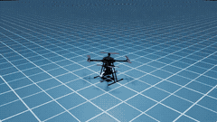
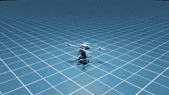
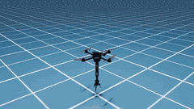
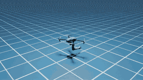
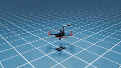
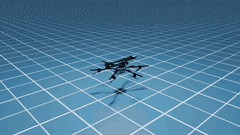

# Aetos_MultiAM

A benchmark for **multi aerial-manipulator (AM) collaboration**: one robot
*type* -- an aerial manipulator (drone + optional arm + optional gripper) --
composed from swappable drone / manipulator / gripper models, built on Isaac
Sim's `omni.isaac.core` API.

📖 **中文详细手册: [`docs/MANUAL_ZH.md`](docs/MANUAL_ZH.md)** -- 已验证到什么程度、
每个机型为什么这样配、八个已修复的缺陷、每个脚本的完整参数说明。

## Key features

- **Six aerial manipulators, all flyable** -- five under-actuated quadrotors
  and one fully-actuated hexarotor, arms from 2 to 6 DOF, end effectors from a
  single jaw to a 12-DOF dexterous hand. See [Embodiments](#embodiments).
- **Keyboard teleoperation of the drone *and* the arm**, as two independently
  selected devices; a real SO-ARM leader arm also drives the SO-ARM presets.
- **Arm-reaction isolation** -- a moving arm costs under 0.7 deg of body tilt
  on every robot, so a controller tuned for a fixed airframe stays stable
  (`arm_dynamics_residual`, `arm_locked_joints`, `arm_write` per preset).
- **6-DOF wrench allocation** for the fully-actuated hexarotor, so it
  translates at a level attitude instead of leaning: worst body tilt over the
  whole mission drops from 8.09 deg to 0.53 deg.
- **Composable assets** -- drone x manipulator x gripper mounted at runtime,
  or baked into a standalone USD per preset.

## Embodiments

Each clip is that robot flying `examples/show_am_action.py`'s scripted mission
at **3x speed**: climb to 1 m, forward 1 m, left 1 m, right 1 m, yaw 180 deg,
forward 1 m, sweep every drivable joint +-45 deg, land.

| preset | rotors | arm DOF | gripper DOF | mission (3x) |
|---|---|---|---|---|
| `amov950_airbot_bottom` | quad (4) | 6 | 2 (airbot_play) |  |
| `amov950_airbot_dexterous_bottom` | quad (4) | 5 | 12 (Inspire Hand) |  |
| `hummingbird340_2dof_gripper` | quad (4) | 2 | 3 (three-finger) |  |
| `iris650_soarm100` | quad (4) | 5 | 1 (SO-ARM jaw) |  |
| `uaquad600_gripper` | quad (4) | 4 | 2 (two-finger) |  |
| `fahexa750_gripper` | **hexa (6)** | 4 | 2 (two-finger) |  |

These six are a fixed set, not an arbitrary runtime combo picker.
`fahexa750_gripper` is fully actuated (6x6 wrench matrix, rank 6, condition
number 4.2): it is flown through a 6-DOF allocator that commands force and
attitude independently, so it slides sideways without tilting. The other five
are under-actuated and lean to translate, as they must. `--controller lee`
flies the hexa the under-actuated way for comparison.

## Setup

```bash
pip install -e /home/benhua/OmniDrones   # aetos_multiam imports omni_drones directly
pip install -e .
```

Robot model binaries (USD + MJCF mesh geometry) aren't committed -- download
them and unzip into `aetos_multiam/assets/meshes`, see
[`docs/ASSETS.md`](docs/ASSETS.md).

Every script below needs Isaac Sim on the interpreter's path:

```bash
export ISAACSIM_PATH=/home/benhua/isaacsim
conda activate omnidrone
```

## Usage

### View a preset

```bash
python examples/show_robot.py --robot iris650_soarm100
python examples/show_robot.py --robot all            # all six side by side
python examples/show_robot.py --robot all --headless # screenshot only
```

### Fly the scripted mission

```bash
python examples/show_am_action.py --preset uaquad600_gripper
python examples/show_am_action.py --preset all     # all six in one scene
python examples/show_am_action.py --preset all --headless --video out.mp4

# fly the fully-actuated hexa as an under-actuated one, to see the difference
python examples/show_am_action.py --preset fahexa750_gripper --controller lee
```

### Teleoperate

`examples/aerial_manipulator_control_demo.py` drives the drone body and the
arm from two independently-selected devices:

| flag | values | default |
|---|---|---|
| `--uav_control` | `none`, `keyboard` | `none` (holds its spawn setpoint) |
| `--arm_control` | `none`, `keyboard`, `soarm_leader` | `none` (holds its rest pose) |
| `--arm_dynamics` | `frozen`, `coupled` | `frozen` (arm doesn't push back) |
| `--mode` | `dynamic`, `kinematic` | real rotor thrust vs. teleported pose |
| `--controller` | `auto`, `lee`, `fa` | `auto` (6-DOF where the airframe allows) |

Keys -- drone: `WASD` translate, `E`/`Q` up/down, `Left`/`Right` yaw. Arm:
`1`-`9` select a joint, `]`/`[` **or** `Up`/`Down` move it, `G`/`H` close/open
every gripper DOF, `Z` home the arm. The arm bindings are generic over whatever DOFs the preset
has, so the same keys drive a 2-DOF arm or a 12-DOF dexterous hand.

```bash
# fly a preset and drive its arm, both from the keyboard
python examples/aerial_manipulator_control_demo.py --preset iris650_soarm100 \
    --mode dynamic --uav_control keyboard --arm_control keyboard

# ...with the arm driven by a real SO-ARM leader instead
python examples/aerial_manipulator_control_demo.py --preset iris650_soarm100 \
    --mode dynamic --uav_control keyboard --arm_control soarm_leader --arm-port /dev/ttyACM0
```

`examples/amteleop_soarm_leader.py` is the leader-arm-only path (drone welded
to the world); serial permissions and first-run calibration in
[`docs/TELEOP.md`](docs/TELEOP.md).

### Run a task

```bash
python scripts/run_button_grasp.py headless=true
python scripts/run_shelf_button_grasp.py task=ShelfButtonGrasp headless=true

# shelf scene with pluggable drone/arm control sources (policy / replay / device)
python examples/run_task_ShelfButtonGrasp.py --headless --max_steps 500
```

Scene and robot are both config: `task=<SceneName>` picks the scene,
`aerial_manipulators.0.preset=<name>` picks the robot, no code change.

### Regenerate combined USDs

```bash
python scripts/export_robot_usd.py --config scripts/export_configs/iris650_soarm100.yaml
```

One config per output file under `scripts/export_configs/`.

## Layout

```
aetos_multiam/
  robots/{drones,manipulators,grippers}/   # swappable component specs + registries
  robots/robot_base.py                     # AerialManipulatorBase: runtime composition
  robots/presets.py                        # the six named combos (PRESETS)
  devices/                                 # teleop input devices (keyboard UAV + arm, SO-ARM leader)
  actuators/, controllers/                 # rotor thrust, arm/gripper/composite controllers
  scenes/, objects/                        # arenas and task objects
  environments/single/                     # ButtonGrasp, ShelfButtonGrasp, ShelfBucketGrasp
  environments/collaborative/              # 5 config-driven multi-AM tasks (scaffolding)
  utils/usd_compose.py                     # the drone x arm x gripper mounting mechanism
  utils/arm_dynamics.py                    # arm-reaction isolation
  controllers/drone/allocation.py          # 6-DOF wrench allocation (fully-actuated airframes)
  utils/usd_fixups.py                      # vendored-asset repairs applied at spawn
cfg/task/                                  # hydra task configs
scripts/                                   # task entry points + USD export tooling
examples/                                  # show_robot, show_am_action, teleop demos
```

## Docs

| | |
|---|---|
| [`docs/MANUAL_ZH.md`](docs/MANUAL_ZH.md) | 中文详细手册 -- 验证状态、机型配置理由、已修缺陷、脚本参数 |
| [`docs/ARCHITECTURE.md`](docs/ARCHITECTURE.md) | how this is organized, and the asset table (real vs. scaffolding) |
| [`docs/ASSETS.md`](docs/ASSETS.md) | where the model binaries come from and where they go |
| [`docs/ARM_DISTURBANCE.md`](docs/ARM_DISTURBANCE.md) | how much a moving arm kicks the drone, measured per robot |
| [`docs/TELEOP_CONTROL_MODES.md`](docs/TELEOP_CONTROL_MODES.md) | what drives the drone, what drives the arm, per preset |
| [`docs/TELEOP.md`](docs/TELEOP.md) | real SO-ARM leader setup |
